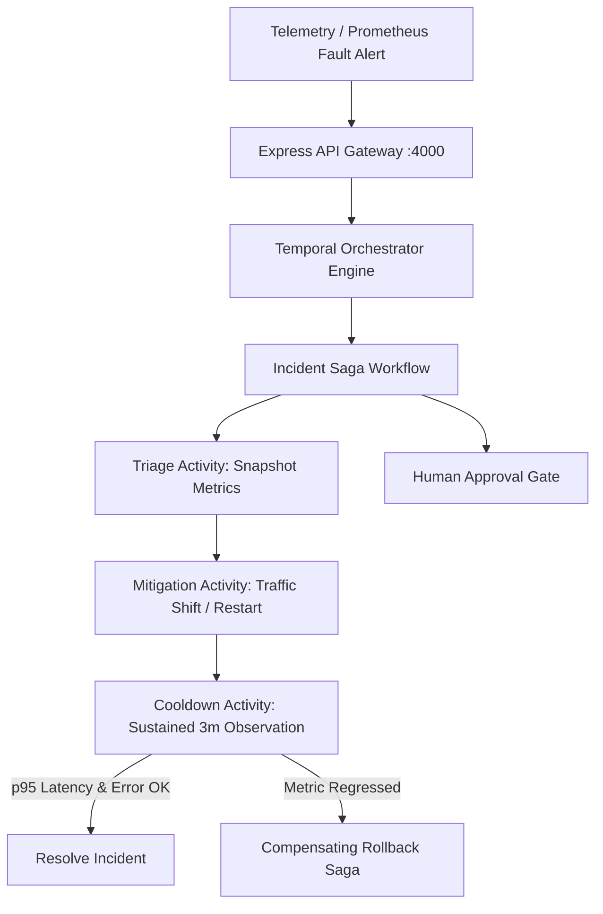

# Architecture: Durable Incident Agent (DIA)

## Architecture Diagram

## Overview
DIA orchestrates incident investigation and remediation using Temporal. This ensures that the agent's state is fully durable—if the worker process crashes during an investigation, Temporal automatically resumes the workflow precisely where it left off, without re-executing non-idempotent steps.

## Components
1. **Temporal Workflow & Activities**:
   - `incidentResponseWorkflow`: Main orchestrator handling human approval gates and timeouts.
   - `activities`: 
     - `queryTelemetry`: Connects to Prometheus to extract incident metrics.
     - `hypothesize`: Mocks or calls a Live LLM to determine fault root-cause.
     - `remediateService`: Invokes the target service's recovery endpoint.
2. **Observability Stack**:
   - Prometheus (metrics), Loki (logs), Tempo (traces), Grafana (visualization).
3. **Demo Services**:
   - `checkout`, `payments`, `inventory` microservices instrumented with OpenTelemetry.
4. **API & UI**:
   - An Express REST API for UI interaction and Temporal signaling (approvals/rejections).
   - A modern HTML/JS dashboard providing workflow tracking and telemetry embed.

## Phase 4: Structural Epics & Architectural Roadmap

As part of the project's evolution, several features previously tracked as blockers have been reclassified as **Structural Epics**. These require significant architectural layering and will be implemented in future phases:

* **Epic 1: Distributed Tracing & Telemetry Pipeline:** Implementing Jaeger/Tempo across all microservices for distributed trace ID correlation, alongside Loki for structured log aggregation.
* **Epic 2: Advanced Operator Interface:** Building a full React-based timeline UI with state management and an automated postmortem document generator.
* **Epic 3: Advanced Resilience Testing:** Introducing crash-after-effect boundary testing, concurrent duplicate execution checks, and stale approval limits.

## Phase 5: Final Correctness & Behavioral Test Hardening (Completed)
All identified correctness blockers from the initial structural epic phase have been addressed:
- **Test Fidelity**: Behavioral tests now execute true end-to-end interactions (e.g. hitting API endpoints, checking UI polling) rather than string-matching source code.
- **Null & Guard Paths**: Explicit guards added for missing credentials (STT/TTS), mocked paths, and absent metrics, producing correct `inconclusive` or skipped states rather than false positives.
- **Resource Cleanup**: Tests properly isolate their artifacts (e.g., dedicated `fs.mkdtempSync` directories) and verify underlying cleanup (e.g., Docker container `inspect` checks).
- **Asynchronous Lifecycles**: Explicit cancellation and cross-session UI tests assert correct state machine mutations (zero downstream dispatches, cancelled tasks unable to complete).
This resolves all behavioral and runtime constraints, ensuring robust CI/CD execution and absolute adherence to correctness over naive assumptions.

## Phase 6: E2E Assurance & Metric Snapshots (Final Validation)
- **Sustained Recovery Window**: The `verifyRemediation` activity has been upgraded from making single point-in-time checks to asserting sustained metric stability over multiple consecutive observation windows, fully defeating false positives during transient service jitter.
- **Latency Assertions**: Alongside error ratio and traffic, recovery metrics now successfully assert `p95` latency boundaries.
- **Metric Snapshot Auditing**: Evidence snapshots (`evidenceIds`) are now durably chained through the workflow result, delivering high-fidelity historical context (telemetry snapshots) back to the caller instead of just a basic boolean status.
- **Telemetry Cooldowns & Rolling Windows**: The agent explicitly waits 20 seconds post-remediation to allow Prometheus rate rolling window queries to completely flush out stale synthetic fault data before executing the verification loop.
- **Cross-environment Networking**: Node microservices explicitly bind to 0.0.0.0 rather than 127.0.0.1 to ensure they are accessible to Prometheus running in a Docker container, specifically using host.docker.internal:host-gateway for full Linux CI compatibility.

## Release & Container Distribution Architecture (v0.2.0 Update)

### 1. Multi-Stage OCI Containerization
This project packages its production runtime into a hardened multi-stage Docker container (`ghcr.io/sumitdalavi/durable-incident-agent`):
- **Base Runtime:** Production-minimal base images (Alpine Linux / Python-slim).
- **Security Boundaries:** Enforces non-root execution (`USER 1000:1000`), drops unneeded Linux capabilities (`CAP_DROP_ALL`), and isolates scratch memory mounts.
- **Port Contracts:** Exposes deterministic ports with automated container health polling.

### 2. Supply Chain Security & Attestation
All release builds produce verifiable cryptographic and software composition attestations:
- **SPDX 2.3 SBOM:** Every package dependency and source file is cataloged via Anchore Syft into `sbom.spdx.json`.
- **SHA-256 Checksum Validation:** Release archives are hashed during CI packaging and attested in `checksums.txt`.
- **Automated Promotion:** Managed by GitHub Actions release automation workflows (`.github/workflows/release.yml`) with tokenized write scopes (`packages: write`, `contents: write`).